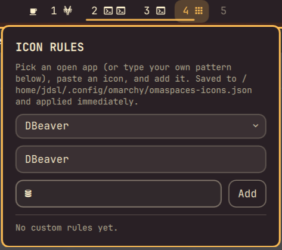

# Omaspaces

Configurable Hyprland workspace indicators for the [Omarchy](https://omarchy.org/) bar: each pill shows the workspace number plus a glyph for every open window's app, with layout, sizing, and icon rules you control.


## What you see

- **Pills** — one per workspace, numbered, holding a small glyph for each open
  window's app (capped, with a `+N` overflow past the limit).
- **Active state** — the focused (or urgent) workspace gets a soft background
  fill in your accent color; nothing else changes shape.
- **Click** a pill to focus that workspace; **scroll** over any pill to step
  to the next/previous one; **hover** for a tooltip listing that workspace's
  open window titles; **right-click** to open the icon rules editor.

## Requirements

- Omarchy (Quattro) running on Hyprland
- A Nerd Font installed and set as the bar font, so app glyphs render

## Installation

```sh
omarchy plugin add https://github.com/DanielLob-o/Omaspaces.git --enable
omarchy bar put lobo.omaspaces --section center
```

Omarchy's built-in `omarchy.workspaces` widget is often already on the bar
too, which means you'll see two workspace indicators side by side until you
disable it:

```sh
omarchy plugin disable omarchy.workspaces
```

## Configuration

Omarchy doesn't have a settings-panel GUI for bar widgets yet — set a key
with `omarchy bar set lobo.omaspaces <key> <value>`, which writes it to the
widget's entry in `~/.config/omarchy/shell.json` (hand-editing that file
works too, and hot-reloads on save). Booleans and numbers need `--json`, or
they're written as plain strings — which for a boolean means `false` (the
string) is truthy, silently turning the setting *on*:

```sh
omarchy bar set lobo.omaspaces compact true --json
omarchy bar set lobo.omaspaces workspaceCount 6 --json
```

| Setting | Description |
|---|---|
| Show app icons | Render a glyph per open window inside its workspace pill |
| Show workspace numbers | Show the workspace number |
| Base workspace count | Workspaces always shown, even empty |
| Highest workspace shown | Ceiling for extra workspaces that appear once occupied |
| Hide empty extra workspaces | Drop (rather than dim) empty workspaces above the base count |
| Max icons per workspace | Caps icons per pill before collapsing into a `+N` |
| Active color | `Accent`, `Urgent`, or `Foreground` palette role, shown as a soft background fill on the focused (or urgent) workspace |
| Compact spacing | Tighter padding/gaps between pills |
| Show window titles on hover | Tooltip listing the pill's open window titles |
| Custom icon rules file | Path to the JSON file the icon rules editor (below) reads and writes; defaults to `~/.config/omarchy/omaspaces-icons.json` |

### Built-in icon rules

App-to-icon rules live in `IconRules.js`, split into a small `titleRules`
list (for apps that need a window title to disambiguate, like browser tabs)
and a larger `classRules` list (matched and cached by window class). Add or
reorder entries there and save; the shell hot-reloads plugin QML on change.

### Adding your own icons

**Right-click any workspace pill** to open the icon rules editor — no file
editing required:

1. Pick an app from the dropdown (populated from your currently open
   windows), or just type a pattern by hand.
2. Paste an icon glyph. Grab one from the
   [Nerd Fonts cheat sheet](https://www.nerdfonts.com/cheat-sheet) — search
   for the app name, click a glyph to copy it.
3. Click **Add**. It applies immediately and is saved to the "Custom icon
   rules file" path above.



Existing rules are listed below the form with a **✕** to remove them. Since
these are checked *before* the built-in rules, the editor also doubles as
the way to replace a built-in icon you don't like.

#### Editing the file directly

The editor is just a UI over a plain JSON file, so you can also hand-edit
it (or manage it with your own tooling/dotfiles):

```json
[
  { "match": "claude-code|claude", "icon": "" },
  { "match": "my-internal-app", "icon": "󰀻" }
]
```

Each entry's `match` is a case-insensitive regular expression tested
against both the window class and title; the first match in the file wins.
The file is watched and re-applied automatically whenever it changes — no
reload or restart needed, whether you edited it by hand or through the
in-widget editor.

If a window's class isn't obvious from the app picker, find it with:

```sh
hyprctl clients | grep -A2 'class:'
```

## Removal

```sh
omarchy plugin remove lobo.omaspaces
```

## License

MIT. See [LICENSE](LICENSE).
