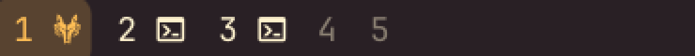

# Omaspaces

Configurable Hyprland workspace indicators for the [Omarchy](https://omarchy.org/) bar: each pill shows the workspace number plus a glyph for every open window's app, with layout, sizing, and icon rules you control.



## What you see

- **Pills** — one per workspace, numbered, holding a small glyph for each open
  window's app (capped, with a `+N` overflow past the limit).
- **Active state** — the focused (or urgent) workspace gets a soft background
  fill in your accent color; nothing else changes shape.
- **Click** a pill to focus that workspace; **scroll** over any pill to step
  to the next/previous one; **hover** for a tooltip listing that workspace's
  open window titles.

## Requirements

- Omarchy (Quattro) running on Hyprland
- A Nerd Font installed and set as the bar font, so app glyphs render

## Installation

```sh
omarchy plugin add https://github.com/DanielLob-o/Omaspaces.git --enable
omarchy bar put lobo.omaspaces --section center
```

## Configuration

Open the widget's settings from the bar's widget settings panel, or set a key
directly with `omarchy bar set lobo.omaspaces <key> <value>`. Booleans and
numbers need `--json`, or they're written to `shell.json` as plain strings —
which for a boolean means `false` (the string) is truthy, silently turning
the setting *on*:

```sh
omarchy bar set lobo.omaspaces compact true --json
omarchy bar set lobo.omaspaces workspaceCount 6 --json
```

| Setting | Description |
|---|---|
| Show app icons | Render a glyph per open window inside its workspace pill |
| Show workspace numbers | Show the workspace number |
| Base workspace count | Workspaces always shown, even empty |
| Highest workspace shown | Ceiling for extra workspaces that appear once occupied |
| Hide empty extra workspaces | Drop (rather than dim) empty workspaces above the base count |
| Max icons per workspace | Caps icons per pill before collapsing into a `+N` |
| Active color | `Accent`, `Urgent`, or `Foreground` palette role, shown as a soft background fill on the focused (or urgent) workspace |
| Compact spacing | Tighter padding/gaps between pills |
| Show window titles on hover | Tooltip listing the pill's open window titles |
| Custom icon rules file | Path to a JSON file of your own icon overrides (see below) |

### Built-in icon rules

App-to-icon rules live in `IconRules.js`, split into a small `titleRules`
list (for apps that need a window title to disambiguate, like browser tabs)
and a larger `classRules` list (matched and cached by window class). Add or
reorder entries there and save; the shell hot-reloads plugin QML on change.

### Adding your own icons

You don't need to edit `IconRules.js` (or fork the plugin) to add or change
an icon — point the widget at your own small JSON file instead:

1. **Find the window's class or title.** With the app open, run:

   ```sh
   hyprctl clients | grep -A2 'class:'
   ```

   Note the `class:` value (and `title:` if the class is too generic, like a
   browser).

2. **Pick a glyph.** Grab one from the
   [Nerd Fonts cheat sheet](https://www.nerdfonts.com/cheat-sheet) — search
   for the app name, click a glyph to copy it.

3. **Create the rules file**, e.g. `~/.config/omarchy/omaspaces-icons.json`:

   ```json
   [
     { "match": "claude-code|claude", "icon": "" },
     { "match": "my-internal-app", "icon": "󰀻" }
   ]
   ```

   Each entry's `match` is a case-insensitive regular expression tested
   against both the window class and title; the first match in the file
   wins. Since these are checked *before* the built-in rules, the same
   mechanism also lets you replace a built-in icon you don't like.

4. **Point the widget at the file**, either through the widget's settings
   panel ("Custom icon rules file") or from the CLI:

   ```sh
   omarchy bar set lobo.omaspaces iconOverridesPath ~/.config/omarchy/omaspaces-icons.json
   ```

The file is watched and re-applied automatically whenever you save it — no
reload or restart needed.

## Removal

```sh
omarchy plugin remove lobo.omaspaces
```

## License

MIT. See [LICENSE](LICENSE).
